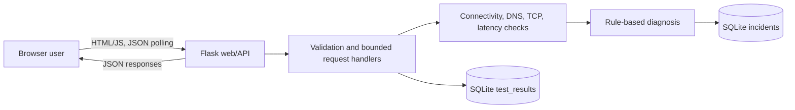
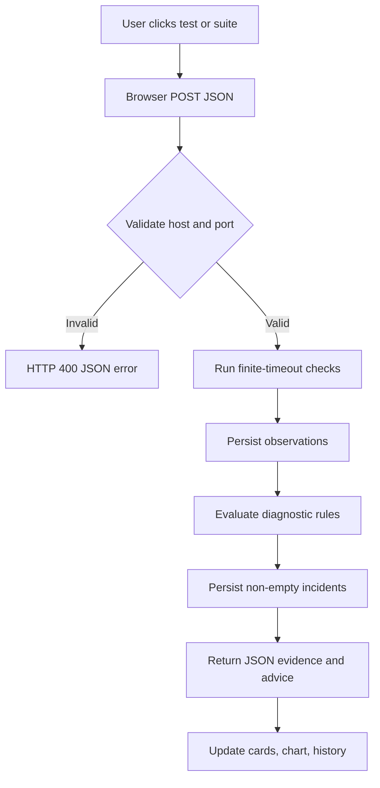

# WhyNet Live — Academic Project Report

## Abstract

WhyNet Live is a web-based network troubleshooting demonstration that collects bounded connectivity, DNS, TCP reachability, and TCP handshake timing measurements from the host running the application. A Flask API validates requests, stores test results and inferred incidents in SQLite, and exposes JSON endpoints to a responsive browser dashboard. A transparent rule-based engine turns collected measurements into findings with evidence strength and recommendations. Checks use explicit timeouts and avoid arbitrary shell execution and port-range scanning. The system is intended for learning and controlled demonstrations; results describe the application host's network path, not a visitor's private device. A finding is not proof of a particular root cause.

## 1. Introduction and problem statement

Connectivity faults span multiple layers. Users often see a service fail but cannot easily tell whether a name lookup, route, TCP service, or elevated delay is involved. Command-line tests can be difficult for beginners and usually do not preserve an easily understood history. WhyNet Live places a small set of bounded tests and an evidence-aware explanation panel in one dashboard.

## 2. Objectives and scope

- Measure a fixed outbound TCP connectivity target.
- Resolve a configurable hostname and time a single TCP connection.
- Calculate average/min/max successful TCP handshake duration and failed-attempt ratio.
- Save observations and rule-based incidents in SQLite.
- Return JSON through a documented Flask API and render a responsive dashboard.
- Validate user-controlled host/port values and cap attempts/timeouts.
- Use mocks so automated tests run without network access.

Out of scope: LAN discovery, arbitrary port scanning, packet capture, ICMP-based loss measurement, endpoint-device diagnosis, automated remediation, and causal root-cause certainty.

## 3. Existing and proposed systems

**Existing approach:** separate terminal commands, ephemeral observations, and operator interpretation. Results can be hard to compare and lack a clear qualification of what was actually measured.

**Proposed approach:** a single web dashboard with bounded tests, timestamped history, transparent heuristics, and explicit measurement limitations. The app remains a demonstration rather than an autonomous network-management platform.

## 4. Requirements

### Functional

1. Provide health/status, individual test, full-suite, history, and incident APIs.
2. Show internet/DNS/TCP/latency/failed-attempt indicators, trend chart, and recent results.
3. Distinguish failed or unavailable values from numeric zero.
4. Identify DNS, connectivity, TCP, high-latency, possible failed attempts, intermittent behavior, and insufficient-evidence conditions where input supports them.
5. Persist result metadata and incident evidence.

### Non-functional

Responsive layout; bounded network operations; input validation; readable code; small dependency set; no network requirement for unit tests; no fabricated sample outcomes; no user-supplied shell execution.

## 5. Hardware and software

A modest computer/server with Python 3.10+, pip, and a browser is sufficient. Runtime dependencies are Flask and Gunicorn; pytest is used for tests. SQLite is included with Python. Live external tests require outbound network access from the host.

## 6. System architecture



### Data-flow diagram



### Use-case diagram (text)

```text
Actor: Student / Demonstrator
  ├─ View dashboard and health
  ├─ Run connectivity test
  ├─ Run DNS test
  ├─ Test one authorized TCP host/port
  ├─ Run full diagnostic suite
  ├─ Inspect evidence and troubleshooting suggestions
  ├─ Pause/resume browser polling
  └─ Review persisted test and incident history
```

## 7. Modules

- `app.py`: Flask factory, routes, API validation, bounded concurrent suite.
- `config.py`: timeout and threshold configuration.
- `diagnostics/checks.py`: hostname validation and socket-based checks.
- `diagnostics/fault_engine.py`: deterministic diagnosis rules and evidence statements.
- `database/db.py`: table setup and SQLite persistence/history queries.
- `templates/index.html`, `static/css/style.css`, `static/js/dashboard.js`: dashboard and polling.
- `tests/`: mocked checks, rule tests, and API persistence tests.

## 8. Database schema

`test_results(id, test_type, target, status, latency_ms, details, created_at)` stores each observation and JSON details. `incidents(id, category, severity, summary, evidence, recommendations, confidence, created_at)` stores non-empty inferred findings. Index: `test_results(created_at DESC)`. The seed script initializes schema only and does not invent records.

## 9. Diagnostic algorithm and pseudocode

```text
collect available test results
if fixed IP TCP connectivity fails:
  report configured-target reachability failure (not universal outage)
if DNS fails and independent IP TCP check succeeds:
  report possible DNS-related issue with stronger evidence
else if DNS alone fails:
  report DNS failure with limited attribution
if requested TCP fails while fixed connectivity succeeds:
  report service/port unreachability as a possibility
if average successful TCP timing exceeds threshold:
  report high measured timing
if one or more bounded attempts fail:
  report possible failed attempts (not ICMP packet loss)
if some timing attempts fail but other connectivity succeeds:
  report intermittent behavior as a possibility
if no rule matched:
  report insufficient evidence
persist non-empty findings and return findings plus observations
```

Evidence strength reflects rule support, not calibrated probability. Multiple failures may share one cause; correlations do not establish causation.

## 10. Test plan and results

Automated tests use pytest and mocks so they do not rely on external network availability. Coverage includes valid/invalid host strings, TCP success/refusal/timeout, latency calculations and unavailable measurements, each diagnosis family, invalid API inputs, JSON responses, and SQLite history persistence.

**Execution record:** run `python -m pytest -q` in the project environment. Record the actual pass/fail count and date here after execution; do not infer a result from test definitions. Live network behavior is environment-dependent and is not asserted by the unit tests.

| Case | Expected result |
|---|---|
| Valid hostname/IP | Accepted |
| Malformed hostname / scheme / embedded port | HTTP 400 or `ValueError` |
| Port outside 1–65535 | HTTP 400 |
| Mocked TCP connect | Success result with timing |
| Mocked refusal/timeout | Distinct status, no fabricated latency |
| Mixed timing success and failure | Correct average and failed-attempt ratio |
| All timing attempts fail | `avg_ms = null`, `status = unavailable` |
| DNS fails, IP check succeeds | Possible DNS issue, stronger evidence |
| TCP fails, general check succeeds | Possible service/port reachability issue |
| No findings supported | Insufficient evidence |
| Saved API test | Appears in SQLite history JSON endpoint |

## 11. Installation and demonstration

Follow `README.md` for Windows PowerShell and Linux/macOS commands. Demonstration order: start app; open dashboard; run full suite; inspect evidence strength and limitations; run individual DNS/TCP checks; view history; pause/resume polling. For demonstration screenshots, capture overview, populated findings, history, and mobile layout. No screenshots are bundled or claimed to have been created.

## 12. Limitations and future enhancements

The server's network path is not the visitor's; TCP timing is not ICMP; a handful of attempts is not a robust statistical estimate; DNS resolution depends on OS resolver behavior; public diagnostic endpoints need abuse protection; SQLite local files may be ephemeral or unsuitable for multiple workers; thresholds need environment-specific tuning. Future work could add authenticated user-side agent measurements, a managed database, longer-term time-series aggregation, carefully controlled target allowlists, calibrated confidence, and optional SSE.

## 13. Conclusion

WhyNet Live demonstrates cross-layer network checks, persistence, a REST interface, and explainable rule-based troubleshooting in one compact educational application. Its primary design choice is to present observations and limits honestly: a failed probe is scoped to the attempted target and host, while suggested causes remain hypotheses.

## 14. Viva voce questions and answers

1. **What problem does WhyNet Live address?** It packages several bounded connectivity diagnostics and history in an accessible dashboard.
2. **Why use Flask?** It provides a small Python web/API layer and is easy to teach and extend.
3. **Why SQLite?** It is serverless, included with Python, and suitable for a local academic demonstration.
4. **What is DNS?** The naming system that maps domain names to address records.
5. **What does the DNS test show?** Whether the host resolver returned address records for the requested domain, plus elapsed lookup time.
6. **What is a TCP handshake?** The connection-establishment exchange that precedes application data on a TCP socket.
7. **Is TCP timing the same as ping?** No. This app times a TCP connection attempt; it does not send ICMP echo requests.
8. **Does failed TCP timing prove packet loss?** No. The UI calls these failed attempts; firewalls, services, and timeouts can also cause failure.
9. **Why distinguish unavailable from zero?** No successful sample is missing data, not a measured zero-millisecond connection.
10. **How is a port validated?** It is parsed as an integer and limited to 1–65535; one port is tested per request.
11. **Does the application scan ports?** No. It performs only a single specified TCP connection per test.
12. **Where do deployed checks run?** On the server hosting the Flask app, not on the visitor's computer.
13. **How are network tests kept bounded?** TCP calls have finite socket timeouts; timing attempts are capped; full suite uses a fixed set of checks.
14. **What does the DNS/IP correlation imply?** DNS failure with a separate IP-based success is stronger evidence of a possible resolver issue, not proof.
15. **Why is root cause not claimed?** Several causes can produce the same symptom, and the tests observe only a limited path and targets.
16. **What is an API?** A defined interface—in this project, JSON endpoints used by the dashboard and test clients.
17. **How does the dashboard refresh?** Browser JavaScript polls status/history every 15 seconds while monitoring is enabled.
18. **How are test histories stored?** The `test_results` SQLite table contains type, target, status, latency, JSON details, and timestamp.
19. **What is the purpose of `incidents`?** It persists diagnostic categories, evidence, suggestions, severity, and strength labels.
20. **Why mock network calls in tests?** It makes tests deterministic and runnable offline.
21. **How can high latency be changed?** Set `HIGH_LATENCY_MS` in the runtime environment.
22. **What happens if a target is invalid?** Input validation returns an error; API validation failures use HTTP 400.
23. **Why not use shell `ping`?** ICMP tooling may be unavailable or restricted, and shell invocation adds portability and safety concerns.
24. **What should change before production use?** Add authentication/rate limits, persistent managed storage, operational monitoring, and carefully scoped target policy.
